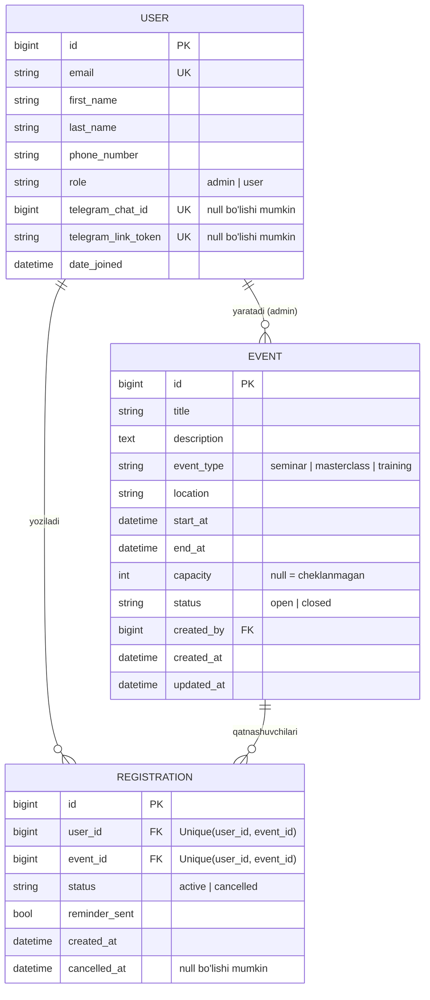

# Evently Backend

O‘quv markazi uchun tadbirlarni (seminar, master-klass, trening) boshqarish platformasining **REST API** va **Telegram bot** backend qismi.

## Asosiy imkoniyatlar

- **Authentication (JWT):** email + parol orqali ro‘yxatdan o‘tish, login, access/refresh token yangilash, profilni ko‘rish va tahrirlash (`role` va `email` API orqali o‘zgarmaydi).
- **Tadbirlar boshqaruvi (Admin):** tadbir yaratish, qisman tahrirlash (`PATCH`), o‘chirish, yopish (`close`), faol qatnashuvchilar ro‘yxatini ko‘rish.
- **Ro‘yxatdan o‘tish va biznes qoidalar (BR-1…BR-10):**
  - Bir foydalanuvchi bir tadbirga faqat bir marta yoziladi (`UniqueConstraint(user, event)` + servis tekshiruvi); chiqib qayta yozilganda mavjud yozuv qayta `active` qilinadi.
  - Oxirgi bo‘sh joy uchun race condition himoyasi (`transaction.atomic()` + `Event.objects.select_for_update()`).
  - Barcha ro‘yxat endpointlarida N+1 yo‘q (`annotate`, `Exists`, `select_related`).
- **Telegram integratsiyasi:**
  - Deep-link orqali hisobni bog‘lash (`/telegram/link/` → bot `/start <token>` → `/telegram/confirm/` + `X-Bot-Secret`).
  - Ro‘yxatdan o‘tish tasdig‘i (foydalanuvchi va bog‘langan adminlarga — T1) `transaction.on_commit(...)` ichida yuboriladi; Telegram xatosi ro‘yxatdan o‘tishni buzmaydi.
  - Tadbir oldidan eslatmalar (T2) `send_event_reminders` management command va atomik `update()` dublikat himoyasi bilan ishlaydi.

## Texnologiyalar

| Texnologiya | Versiya | Vazifasi |
| --- | --- | --- |
| **Python** | 3.11+ | Asosiy dasturlash tili |
| **Django** | 5.1.15 | Web framework va ORM |
| **Django REST Framework** | 3.17.2 | REST API |
| **PostgreSQL** (`psycopg[binary]`) | 3.3.9 | Ma’lumotlar bazasi |
| **djangorestframework-simplejwt** | 5.5.1 | JWT authentication |
| **drf-spectacular** | 0.30.0 | OpenAPI 3 / Swagger UI hujjatlari |
| **django-filter** | 25.1 | Tadbir va ro‘yxatdan o‘tish filtrlari |
| **django-cors-headers** | 4.9.0 | Frontend uchun CORS sozlamalari |
| **django-environ** | 0.14.0 | `.env` muhit o‘zgaruvchilarini o‘qish |
| **httpx** | 0.28.1 | Telegram Bot API va bot → backend HTTP so‘rovlari |
| **aiogram** | 3.24.0 | Telegram bot (alohida jarayon) |
| **pytest / pytest-django** | 8.4.2 / 4.14.0 | Avtomatik testlar |
| **ruff** | 0.17.5 | Lint va kod formatlash |

## Loyiha tuzilmasi

```text
evently/
├── config/                    # Django sozlamalari, URL'lar, custom exception handler
├── apps/
│   ├── users/                 # Custom User modeli, JWT auth, IsAdmin/IsAdminOrReadOnly
│   ├── events/                # Event, Registration, services.py, filters.py, send_event_reminders
│   └── notifications/         # Telegram bog'lash endpointlari, HasBotSecret, T1/T2 servislari
├── bot/                       # aiogram 3 bot (bazaga ulanmaydi, faqat API orqali ishlaydi)
├── docs/TASK.md               # Dastlabki topshiriq hujjati
├── conftest.py                # Umumiy pytest fixture'lari
├── manage.py
├── pyproject.toml
├── requirements.txt
└── .env.example
```

## ER diagramma



## Lokal ishga tushirish (Windows / PowerShell)

**Talablar:** Python 3.11+ va PostgreSQL o‘rnatilgan bo‘lishi kerak.

```powershell
# 1. Repozitoriyni klonlash
git clone https://github.com/abadjonov/evently.git
cd evently

# 2. Virtual muhit yaratish va faollashtirish
python -m venv .venv
.venv\Scripts\Activate.ps1

# 3. Kutubxonalarni o'rnatish
pip install -r requirements.txt

# 4. .env faylini yaratish va qiymatlarni to'ldirish
Copy-Item .env.example .env

# 5. PostgreSQL'da baza yaratish (yoki pgAdmin orqali)
createdb -U postgres evently

# 6. Migratsiyalarni qo'llash
python manage.py migrate

# 7. Admin foydalanuvchi yaratish (email + parol)
python manage.py createsuperuser

# 8. Backend serverni ishga tushirish
python manage.py runserver

# 9. Telegram botni alohida PowerShell oynasida ishga tushirish
python -m bot.main

# 10. Eslatmalarni qo'lda tekshirish
python manage.py send_event_reminders
```

### Eslatmalar uchun cron sozlash (Linux / server)

Tadbir eslatmalari har 10 daqiqada avtomatik yuborilishi uchun `crontab -e` ga quyidagi qatorni qo‘shing (`REMINDER_HOURS_BEFORE` `.env` orqali boshqariladi):

```cron
*/10 * * * * cd /path/to/evently && .venv/bin/python manage.py send_event_reminders >> /var/log/evently_reminders.log 2>&1
```

## Muhit o‘zgaruvchilari (`.env`)

Barcha maxfiy ma’lumotlar faqat `.env` faylida saqlanadi (`.env` `.gitignore` ga kiritilgan, namuna sifatida [`.env.example`](.env.example) berilgan):

| O‘zgaruvchi | Default / Misol | Tavsif |
| --- | --- | --- |
| `DEBUG` | `True` (`False` prod'da) | Django debug rejimi |
| `SECRET_KEY` | `change-me` | Django maxfiy kaliti (kamida 32+ belgili tasodifiy satr tavsiya etiladi) |
| `ALLOWED_HOSTS` | `localhost,127.0.0.1` | Ruxsat etilgan hostlar (vergul bilan) |
| `TIME_ZONE` | `Asia/Tashkent` | Vaqt mintaqasi (`USE_TZ=True`) |
| `DB_NAME` | `evently` | PostgreSQL baza nomi |
| `DB_USER` | `evently` | PostgreSQL foydalanuvchisi |
| `DB_PASSWORD` | `evently` | PostgreSQL paroli |
| `DB_HOST` | `localhost` | PostgreSQL host manzili |
| `DB_PORT` | `5432` | PostgreSQL porti |
| `ACCESS_TOKEN_LIFETIME_MINUTES` | `60` | JWT `access` token amal qilish muddati (daqiqa) |
| `REFRESH_TOKEN_LIFETIME_DAYS` | `7` | JWT `refresh` token amal qilish muddati (kun) |
| `CORS_ALLOWED_ORIGINS` | `http://localhost:3000,http://localhost:5173` | Frontend domenlari (vergul bilan) |
| `TELEGRAM_BOT_TOKEN` | `@BotFather` tokeni | Telegram Bot API tokeni |
| `TELEGRAM_BOT_USERNAME` | `EventlyBot` | Bot username'i (`@` siz, deep-link havola uchun) |
| `BOT_API_SECRET` | tasodifiy uzun satr | Bot → backend `/telegram/confirm/` so‘rovlari uchun `X-Bot-Secret` kaliti |
| `BACKEND_API_URL` | `http://localhost:8000/api/v1` | Bot ulanadigan backend API manzili |
| `REMINDER_HOURS_BEFORE` | `24` | Tadbir boshlanishidan necha soat oldin eslatma yuborilishi |
