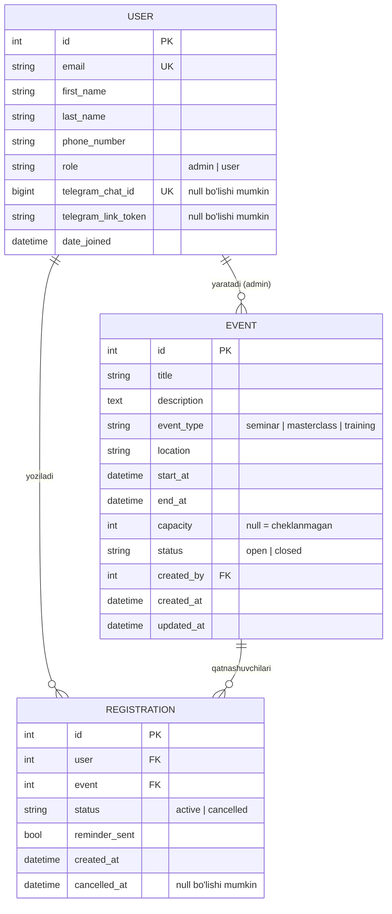
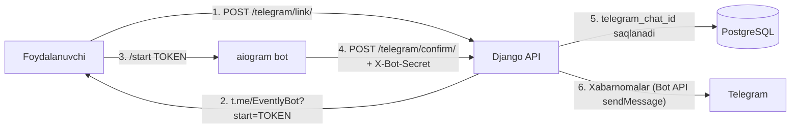

# Evently — tadbirlarni boshqarish platformasi (Backend)

> **Backend Practice Program · 1-loyiha · EASY daraja**
> Muddat: **7–10 kun** · Format: individual · Natija: ishlaydigan REST API + Telegram bot + deployment

Bu repozitoriy — **Evently** loyihasining **faqat backend qismi** uchun. Frontend keyingi bosqichda alohida yaratiladi, shuning uchun bu yerda HTML sahifalar, template'lar yoki frontend kodi yozilmaydi. Sizning vazifangiz — frontend keyinchalik bemalol ulana oladigan, toza va hujjatlashtirilgan **REST API** yaratish.

---

## Mundarija

1. [Loyiha ssenariysi](#1-loyiha-ssenariysi)
2. [Loyiha maqsadi — nimani o‘rganasiz](#2-loyiha-maqsadi--nimani-organasiz)
3. [Loyiha chegarasi (scope)](#3-loyiha-chegarasi-scope)
4. [Texnologiyalar](#4-texnologiyalar)
5. [Rollar va funksiyalar](#5-rollar-va-funksiyalar)
6. [Majburiy biznes qoidalari](#6-majburiy-biznes-qoidalari)
7. [Database dizayni](#7-database-dizayni)
8. [API endpointlar](#8-api-endpointlar)
9. [Request / Response namunalari](#9-request--response-namunalari)
10. [Validation va xatolar](#10-validation-va-xatolar)
11. [Ruxsatlar (permissions) jadvali](#11-ruxsatlar-permissions-jadvali)
12. [Telegram bot](#12-telegram-bot)
13. [Tavsiya etilgan loyiha tuzilmasi](#13-tavsiya-etilgan-loyiha-tuzilmasi)
14. [Muhit o‘zgaruvchilari (.env)](#14-muhit-ozgaruvchilari-env)
15. [Loyihani ishga tushirish](#15-loyihani-ishga-tushirish)
16. [Testlash](#16-testlash)
17. [Deployment](#17-deployment)
18. [Kunlik ish rejasi](#18-kunlik-ish-rejasi)
19. [MVP'dan keyingi qo‘shimcha topshiriqlar](#19-mvpdan-keyingi-qoshimcha-topshiriqlar)
20. [Git bilan ishlash qoidalari](#20-git-bilan-ishlash-qoidalari)
21. [AI Agentlardan foydalanish qoidalari](#21-ai-agentlardan-foydalanish-qoidalari)
22. [Baholash mezonlari](#22-baholash-mezonlari)
23. [Loyiha himoyasi](#23-loyiha-himoyasi)
24. [Topshirish tartibi va yakuniy checklist](#24-topshirish-tartibi-va-yakuniy-checklist)
25. [Ko‘p uchraydigan xatolar va maslahatlar](#25-kop-uchraydigan-xatolar-va-maslahatlar)
26. [Foydali manbalar](#26-foydali-manbalar)

---

## 1. Loyiha ssenariysi

Sizdan bir **o‘quv markazi** uchun tadbirlarni boshqarish platformasini yaratish so‘raldi.

Markaz muntazam ravishda **seminar**, **master-klass** va **trening**lar tashkil qiladi. Hozir ro‘yxatga olish Telegram guruh va Excel jadval orqali qo‘lda yuritiladi: kim yozilgani chalkashib ketadi, joylar soni oshib ketadi, odamlar tadbir vaqtini unutib qo‘yadi.

Markaz quyidagini xohlaydi:

- Administrator tadbirlarni tizimga kiritadi va boshqaradi.
- Odamlar sayt orqali tadbirlarni ko‘radi va qatnashish uchun ro‘yxatdan o‘tadi.
- Tizim joylar sonini o‘zi nazorat qiladi.
- Telegram bot ro‘yxatdan o‘tganlik haqida xabar beradi va tadbirdan oldin eslatma yuboradi.

Siz — shu tizimning **backend developeri**siz.

---

## 2. Loyiha maqsadi — nimani o‘rganasiz

Loyiha yakunida siz quyidagilarni mustaqil bajara olishingizni isbotlaysiz:

| Ko‘nikma | Loyihada qayerda uchraydi |
| --- | --- |
| **Authentication** | Ro‘yxatdan o‘tish, login, JWT token |
| **CRUD** | Tadbir yaratish, ko‘rish, tahrirlash, o‘chirish |
| **Relationship** | `User` ↔ `Registration` ↔ `Event` (many-to-many orqali oraliq model) |
| **Permissions** | Admin va oddiy foydalanuvchi huquqlari |
| **Validation** | Sana, joylar soni, takroriy yozilish va boshqa qoidalar |
| **Business logic** | Yozilish / chiqish qoidalari, tadbirni yopish |
| **API dizayn** | RESTful endpointlar, status kodlar, pagination, filter |
| **Hujjatlashtirish** | Swagger (OpenAPI) |
| **Integratsiya** | Telegram bot (aiogram) |
| **Testing** | Asosiy biznes qoidalar uchun avtomatik testlar |
| **Deployment** | Loyihani internetga chiqarish |

---

## 3. Loyiha chegarasi (scope)

### ✅ Bu repoda qilinadi

- Django + DRF asosidagi REST API.
- PostgreSQL ma’lumotlar bazasi.
- JWT authentication.
- Swagger hujjatlari.
- Telegram bot (aiogram).
- Eslatmalarni yuborish mexanizmi.
- Avtomatik testlar.
- Deployment.

### ❌ Bu repoda qilinmaydi

- Frontend (React, Vue, HTML template va h.k.) — keyingi bosqichda alohida qilinadi.
- To‘lov tizimi.
- Email yuborish (ixtiyoriy bonus sifatida mumkin).

> **Muhim:** Frontend keyin ulanadi. Shuning uchun API'ni **frontend developer uchun yozayotgandek** loyihalang: aniq maydon nomlari, bir xil javob formati, tushunarli xato xabarlari va to‘liq Swagger hujjati.

---

## 4. Texnologiyalar

### Majburiy

| Texnologiya | Vazifasi |
| --- | --- |
| **Python 3.11+** | Asosiy til |
| **Django 5.x** | Web framework |
| **Django REST Framework** | REST API |
| **PostgreSQL** | Ma’lumotlar bazasi |
| **djangorestframework-simplejwt** | JWT authentication |
| **drf-spectacular** | Swagger / OpenAPI hujjatlari |
| **aiogram 3.x** | Telegram bot |
| **Git / GitHub** | Versiyalarni boshqarish |

### Tavsiya etiladi

| Kutubxona | Vazifasi |
| --- | --- |
| `django-environ` yoki `python-dotenv` | `.env` dan sozlamalarni o‘qish |
| `psycopg[binary]` | PostgreSQL drayveri |
| `django-filter` | Filtrlash |
| `django-cors-headers` | Keyinchalik frontend ulanishi uchun CORS |
| `requests` yoki `httpx` | Backend'dan Telegram'ga xabar yuborish |
| `pytest` + `pytest-django` | Testlar (yoki Django'ning o‘z `TestCase`'i) |
| `ruff` yoki `black` | Kod formatlash |

### Bonus (majburiy emas)

- Docker + docker-compose
- Celery / APScheduler (eslatmalar uchun)
- GitHub Actions (testlarni avtomatik ishga tushirish)

---

## 5. Rollar va funksiyalar

Tizimda ikkita rol bor: **Admin** va **Oddiy foydalanuvchi (User)**.

### 5.1. Admin

| # | Funksiya | Izoh |
| --- | --- | --- |
| A1 | Tadbir yaratish | Faqat admin |
| A2 | Tadbirni tahrirlash | Nomi, tavsifi, turi, sanasi, joyi, joylar soni |
| A3 | Tadbirni o‘chirish | |
| A4 | Tadbir sanasi va joyini belgilash | `start_at`, `end_at`, `location` |
| A5 | Qatnashuvchilar ro‘yxatini ko‘rish | Faqat faol ro‘yxatdan o‘tganlar |
| A6 | Tadbirni yopish | Yopilgan tadbirga hech kim yozila olmaydi |

### 5.2. Oddiy foydalanuvchi

| # | Funksiya | Izoh |
| --- | --- | --- |
| U1 | Ro‘yxatdan o‘tish (sign up) | Email + parol |
| U2 | Login | JWT token oladi |
| U3 | Tadbirlar ro‘yxatini ko‘rish | Pagination, filter, qidiruv |
| U4 | Tadbir haqida batafsil ma’lumot | Bo‘sh joylar soni bilan |
| U5 | Tadbirga yozilish | Biznes qoidalarga bo‘ysunadi |
| U6 | O‘zi yozilgan tadbirlarni ko‘rish | |
| U7 | Tadbirdan chiqish (ro‘yxatdan chiqish) | Tadbir boshlanmagan bo‘lsa |
| U8 | Telegram hisobini bog‘lash | Xabarnomalar olish uchun |

### 5.3. Telegram bot

| # | Funksiya | Kimga |
| --- | --- | --- |
| T1 | Yangi ro‘yxatdan o‘tish haqida xabar | Foydalanuvchiga (tasdiq) va adminlarga (yangi qatnashuvchi) |
| T2 | Tadbir boshlanishidan oldin eslatma | Tadbirga yozilgan foydalanuvchilarga |

> **Eslatma:** Tizimga ochiq API orqali ro‘yxatdan o‘tgan har bir foydalanuvchi **oddiy foydalanuvchi** bo‘ladi. Admin faqat `createsuperuser` yoki Django Admin panel orqali yaratiladi. API orqali o‘zini admin qilib qo‘yish imkoniyati bo‘lmasligi shart.

---

## 6. Majburiy biznes qoidalari

Bu qoidalar — loyihaning yuragi. Ularning har biri **backend'da** tekshirilishi va **test bilan** qoplanishi kerak.

| # | Qoida | Qanday tekshiriladi |
| --- | --- | --- |
| **BR-1** | Bir foydalanuvchi bir tadbirga **faqat bir marta** yozila oladi | DB darajasida `UniqueConstraint` + serializer/service'da tekshiruv |
| **BR-2** | Tadbir qatnashuvchilari soni **cheklangan bo‘lishi mumkin** | `capacity = null` → cheklanmagan; `capacity = 30` → 30 tadan ortiq faol yozilish bo‘lmaydi |
| **BR-3** | **Tugagan** (boshlanib ketgan) tadbirga yozilish mumkin emas | `start_at <= hozir` bo‘lsa — rad etiladi |
| **BR-4** | **Faqat admin** tadbir yarata, tahrirlay va o‘chira oladi | Permission class |
| **BR-5** | **Yopilgan** tadbirga yozilish mumkin emas | `status = closed` bo‘lsa — rad etiladi |
| **BR-6** | Tadbir boshlangandan keyin undan **chiqib bo‘lmaydi** | `start_at <= hozir` bo‘lsa — rad etiladi |
| **BR-7** | `end_at` har doim `start_at` dan **keyin** bo‘lishi kerak | Serializer validation |
| **BR-8** | Yangi tadbir **o‘tgan sanaga** yaratilmaydi | Serializer validation |
| **BR-9** | `capacity` ni hozirgi faol qatnashuvchilar sonidan **kamaytirib bo‘lmaydi** | Update paytida tekshiruv |
| **BR-10** | Foydalanuvchi faqat **o‘zining** ro‘yxatdan o‘tishlarini ko‘radi | Queryset `request.user` bo‘yicha filtrlanadi |

### Tadbirga yozilish algoritmi

```
Foydalanuvchi POST /api/v1/events/{id}/register/ yuboradi
│
├── Tadbir mavjudmi?                         yo‘q → 404
├── Tadbir yopilganmi? (status = closed)     ha  → 400 "Tadbir yopilgan"
├── Tadbir boshlanib ketganmi?               ha  → 400 "Tadbir allaqachon boshlangan"
├── Foydalanuvchi allaqachon yozilganmi?     ha  → 400 "Siz bu tadbirga allaqachon yozilgansiz"
├── Joy qolganmi? (capacity cheklangan bo‘lsa) yo‘q → 400 "Bo‘sh joy qolmagan"
│
└── Hammasi joyida → Registration yaratiladi (yoki bekor qilingani qayta faollashtiriladi)
                     → 201 Created
                     → Telegram xabarnoma yuboriladi (T1)
```

---

## 7. Database dizayni

Uchta asosiy model: **`User`**, **`Event`**, **`Registration`**.

### 7.1. ER diagramma



### 7.2. `User`

Django'ning `AbstractUser` modelidan meros oling. **Custom User modelni loyihaning eng boshida, birinchi `migrate` dan oldin yarating** — keyin o‘zgartirish juda qiyin.

| Maydon | Turi | Izoh |
| --- | --- | --- |
| `email` | `EmailField(unique=True)` | Login uchun ishlatiladi (`USERNAME_FIELD = "email"`) |
| `first_name`, `last_name` | `CharField` | |
| `phone_number` | `CharField(blank=True)` | Ixtiyoriy (himoyada majburiy qilinishi mumkin!) |
| `role` | `CharField(choices)` | `admin` yoki `user`, default — `user` |
| `telegram_chat_id` | `BigIntegerField(null=True, unique=True)` | Bot bog‘langandan keyin to‘ldiriladi |
| `telegram_link_token` | `CharField(null=True, unique=True)` | Botni bog‘lash uchun vaqtinchalik token |

### 7.3. `Event`

| Maydon | Turi | Izoh |
| --- | --- | --- |
| `title` | `CharField(max_length=200)` | Majburiy |
| `description` | `TextField` | Majburiy |
| `event_type` | `CharField(choices)` | `seminar`, `masterclass`, `training` |
| `location` | `CharField(max_length=255)` | Masalan: "IT Park, 3-qavat, 301-xona" |
| `start_at` | `DateTimeField` | Boshlanish vaqti |
| `end_at` | `DateTimeField` | Tugash vaqti, `start_at` dan keyin |
| `capacity` | `PositiveIntegerField(null=True, blank=True)` | `null` — cheklanmagan |
| `status` | `CharField(choices)` | `open` (default) yoki `closed` |
| `created_by` | `ForeignKey(User, on_delete=SET_NULL, null=True)` | Tadbirni yaratgan admin |
| `created_at`, `updated_at` | `DateTimeField` | `auto_now_add` / `auto_now` |

**Hisoblanadigan (DB'da saqlanmaydigan) maydonlar** — API javobida qaytariladi:

| Maydon | Qanday hisoblanadi |
| --- | --- |
| `registered_count` | `status = active` bo‘lgan registration'lar soni |
| `available_seats` | `capacity - registered_count` (`capacity = null` bo‘lsa — `null`) |
| `is_finished` | `end_at < hozir` |
| `is_registered` | Joriy foydalanuvchi bu tadbirga faol yozilganmi |

> **Maslahat:** `registered_count` ni har bir tadbir uchun alohida so‘rov bilan hisoblamang. Ro‘yxatda `annotate(Count(..., filter=Q(...)))` dan foydalaning — aks holda **N+1 muammo** yuzaga keladi.

### 7.4. `Registration`

| Maydon | Turi | Izoh |
| --- | --- | --- |
| `user` | `ForeignKey(User, on_delete=CASCADE)` | |
| `event` | `ForeignKey(Event, on_delete=CASCADE, related_name="registrations")` | |
| `status` | `CharField(choices)` | `active` yoki `cancelled` |
| `reminder_sent` | `BooleanField(default=False)` | Eslatma ikki marta yuborilmasligi uchun |
| `created_at` | `DateTimeField(auto_now_add=True)` | |
| `cancelled_at` | `DateTimeField(null=True)` | Ro‘yxatdan chiqqan vaqt |

**Majburiy constraint:**

```python
class Meta:
    constraints = [
        models.UniqueConstraint(fields=["user", "event"], name="unique_user_event_registration"),
    ]
```

> **Nega `status` bor, nega shunchaki o‘chirib yubormaymiz?** Ro‘yxatdan chiqish tarixini saqlash real loyihalarda muhim (statistika, nizolar). Foydalanuvchi chiqib, qayta yozilmoqchi bo‘lsa — yangi yozuv yaratilmaydi, mavjud yozuv qayta `active` holatiga o‘tkaziladi.

---

## 8. API endpointlar

Barcha endpointlar `/api/v1/` prefiksi bilan boshlanadi.

### 8.1. Authentication

| Method | Endpoint | Kim uchun | Tavsif |
| --- | --- | --- | --- |
| `POST` | `/api/v1/auth/register/` | Hamma | Yangi foydalanuvchi ro‘yxatdan o‘tishi |
| `POST` | `/api/v1/auth/login/` | Hamma | Email + parol → `access` va `refresh` token |
| `POST` | `/api/v1/auth/token/refresh/` | Hamma | `refresh` token orqali yangi `access` token |
| `GET` | `/api/v1/auth/me/` | Login qilgan | O‘z profilini ko‘rish |
| `PATCH` | `/api/v1/auth/me/` | Login qilgan | O‘z profilini tahrirlash (rol o‘zgartirib bo‘lmaydi!) |

### 8.2. Tadbirlar

| Method | Endpoint | Kim uchun | Tavsif |
| --- | --- | --- | --- |
| `GET` | `/api/v1/events/` | Hamma | Tadbirlar ro‘yxati (pagination, filter, qidiruv) |
| `GET` | `/api/v1/events/{id}/` | Hamma | Tadbir haqida batafsil |
| `POST` | `/api/v1/events/` | Admin | Tadbir yaratish |
| `PATCH` | `/api/v1/events/{id}/` | Admin | Tadbirni tahrirlash |
| `DELETE` | `/api/v1/events/{id}/` | Admin | Tadbirni o‘chirish |
| `POST` | `/api/v1/events/{id}/close/` | Admin | Tadbirni yopish |
| `GET` | `/api/v1/events/{id}/participants/` | Admin | Qatnashuvchilar ro‘yxati |

**`GET /api/v1/events/` uchun query parametrlar:**

| Parametr | Misol | Tavsif |
| --- | --- | --- |
| `page` | `?page=2` | Sahifa raqami (sahifada 10 ta) |
| `event_type` | `?event_type=seminar` | Tadbir turi bo‘yicha filter |
| `status` | `?status=open` | Holat bo‘yicha filter |
| `upcoming` | `?upcoming=true` | Faqat hali boshlanmagan tadbirlar |
| `search` | `?search=django` | `title` va `description` bo‘yicha qidiruv |
| `ordering` | `?ordering=start_at` | Saralash (`start_at`, `-start_at`, `created_at`) |

### 8.3. Ro‘yxatdan o‘tish (Registration)

| Method | Endpoint | Kim uchun | Tavsif |
| --- | --- | --- | --- |
| `POST` | `/api/v1/events/{id}/register/` | Login qilgan | Tadbirga yozilish |
| `POST` | `/api/v1/events/{id}/unregister/` | Login qilgan | Tadbirdan chiqish |
| `GET` | `/api/v1/me/registrations/` | Login qilgan | O‘zim yozilgan tadbirlar |

`GET /api/v1/me/registrations/` uchun filter: `?status=active` yoki `?status=cancelled`.

### 8.4. Telegram

| Method | Endpoint | Kim uchun | Tavsif |
| --- | --- | --- | --- |
| `POST` | `/api/v1/telegram/link/` | Login qilgan | Botni bog‘lash uchun havola olish |
| `POST` | `/api/v1/telegram/confirm/` | Faqat bot (`X-Bot-Secret` header) | Bot foydalanuvchini bog‘laydi |

### 8.5. Hujjatlar

| Endpoint | Tavsif |
| --- | --- |
| `/api/schema/` | OpenAPI schema (YAML/JSON) |
| `/api/docs/` | Swagger UI |
| `/admin/` | Django Admin panel |

> Swagger'da har bir endpoint uchun **tavsif**, **request misoli** va **mumkin bo‘lgan javoblar** ko‘rinishi kerak. Buning uchun `@extend_schema` dekoratoridan foydalaning.

---

## 9. Request / Response namunalari

### 9.1. Ro‘yxatdan o‘tish

**Request** — `POST /api/v1/auth/register/`

```json
{
  "email": "aziz@example.com",
  "password": "StrongPass123!",
  "password_confirm": "StrongPass123!",
  "first_name": "Aziz",
  "last_name": "Karimov",
  "phone_number": "+998901234567"
}
```

**Response** — `201 Created`

```json
{
  "id": 7,
  "email": "aziz@example.com",
  "first_name": "Aziz",
  "last_name": "Karimov",
  "phone_number": "+998901234567",
  "role": "user"
}
```

> Parol hech qachon javobda qaytarilmaydi va bazada faqat hash ko‘rinishida saqlanadi (`set_password`).

### 9.2. Login

**Request** — `POST /api/v1/auth/login/`

```json
{
  "email": "aziz@example.com",
  "password": "StrongPass123!"
}
```

**Response** — `200 OK`

```json
{
  "access": "eyJhbGciOiJIUzI1NiIsInR5cCI6IkpXVCJ9...",
  "refresh": "eyJhbGciOiJIUzI1NiIsInR5cCI6IkpXVCJ9..."
}
```

Keyingi so‘rovlarda header: `Authorization: Bearer <access>`

### 9.3. Tadbir yaratish (Admin)

**Request** — `POST /api/v1/events/`

```json
{
  "title": "Django REST Framework asoslari",
  "description": "API yaratish bo‘yicha amaliy master-klass. Noutbuk olib keling.",
  "event_type": "masterclass",
  "location": "IT Park, 3-qavat, 301-xona",
  "start_at": "2026-12-05T14:00:00+05:00",
  "end_at": "2026-12-05T17:00:00+05:00",
  "capacity": 30
}
```

**Response** — `201 Created`

```json
{
  "id": 12,
  "title": "Django REST Framework asoslari",
  "description": "API yaratish bo‘yicha amaliy master-klass. Noutbuk olib keling.",
  "event_type": "masterclass",
  "location": "IT Park, 3-qavat, 301-xona",
  "start_at": "2026-12-05T14:00:00+05:00",
  "end_at": "2026-12-05T17:00:00+05:00",
  "capacity": 30,
  "registered_count": 0,
  "available_seats": 30,
  "status": "open",
  "is_finished": false,
  "is_registered": false,
  "created_at": "2026-11-20T10:15:00+05:00"
}
```

### 9.4. Tadbirlar ro‘yxati

**Request** — `GET /api/v1/events/?event_type=masterclass&upcoming=true`

**Response** — `200 OK`

```json
{
  "count": 23,
  "next": "http://localhost:8000/api/v1/events/?event_type=masterclass&page=2&upcoming=true",
  "previous": null,
  "results": [
    {
      "id": 12,
      "title": "Django REST Framework asoslari",
      "event_type": "masterclass",
      "location": "IT Park, 3-qavat, 301-xona",
      "start_at": "2026-12-05T14:00:00+05:00",
      "capacity": 30,
      "available_seats": 12,
      "status": "open",
      "is_registered": true
    }
  ]
}
```

> Ro‘yxat uchun qisqa serializer (`EventListSerializer`), batafsil ko‘rish uchun to‘liq serializer (`EventDetailSerializer`) ishlatish yaxshi amaliyot.

### 9.5. Tadbirga yozilish

**Request** — `POST /api/v1/events/12/register/` (body bo‘sh)

**Response** — `201 Created`

```json
{
  "id": 58,
  "event": {
    "id": 12,
    "title": "Django REST Framework asoslari",
    "start_at": "2026-12-05T14:00:00+05:00",
    "location": "IT Park, 3-qavat, 301-xona"
  },
  "status": "active",
  "created_at": "2026-11-21T09:30:00+05:00"
}
```

**Xato holat** — `400 Bad Request`

```json
{
  "detail": "Bo‘sh joy qolmagan.",
  "code": "event_full"
}
```

### 9.6. Qatnashuvchilar ro‘yxati (Admin)

**Request** — `GET /api/v1/events/12/participants/`

**Response** — `200 OK`

```json
{
  "count": 18,
  "next": null,
  "previous": null,
  "results": [
    {
      "registration_id": 58,
      "user_id": 7,
      "full_name": "Aziz Karimov",
      "email": "aziz@example.com",
      "phone_number": "+998901234567",
      "registered_at": "2026-11-21T09:30:00+05:00"
    }
  ]
}
```

---

## 10. Validation va xatolar

### 10.1. HTTP status kodlari

| Kod | Qachon |
| --- | --- |
| `200 OK` | Muvaffaqiyatli o‘qish / yangilash |
| `201 Created` | Yangi obyekt yaratildi |
| `204 No Content` | Muvaffaqiyatli o‘chirildi |
| `400 Bad Request` | Validation yoki biznes qoida buzildi |
| `401 Unauthorized` | Token yo‘q yoki yaroqsiz |
| `403 Forbidden` | Token bor, lekin huquq yetarli emas |
| `404 Not Found` | Obyekt topilmadi |

### 10.2. Biznes xatolar uchun yagona format

Frontend xatolarni oson ko‘rsata olishi uchun biznes xatolar **bir xil formatda** qaytarilsin:

```json
{
  "detail": "Inson o‘qiy oladigan xabar",
  "code": "mashina_oqiy_oladigan_kod"
}
```

| `code` | `detail` (misol) |
| --- | --- |
| `event_closed` | Tadbir yopilgan. |
| `event_started` | Tadbir allaqachon boshlangan. |
| `already_registered` | Siz bu tadbirga allaqachon yozilgansiz. |
| `event_full` | Bo‘sh joy qolmagan. |
| `not_registered` | Siz bu tadbirga yozilmagansiz. |
| `capacity_too_low` | Joylar soni hozirgi qatnashuvchilar sonidan kam bo‘lishi mumkin emas. |

Field validation xatolari DRF'ning standart formatida qolishi mumkin:

```json
{
  "end_at": ["Tugash vaqti boshlanish vaqtidan keyin bo‘lishi kerak."]
}
```

### 10.3. Validation qoidalari ro‘yxati

**Foydalanuvchi:**

- `email` — unikal, to‘g‘ri formatda.
- `password` — kamida 8 belgi, Django'ning `validate_password` orqali tekshiriladi.
- `password` va `password_confirm` mos kelishi kerak.
- `phone_number` — berilgan bo‘lsa, `+998XXXXXXXXX` formatida.
- `role` — API orqali o‘zgartirib bo‘lmaydi (`read_only`).

**Tadbir:**

- `title` — bo‘sh bo‘lmasligi kerak, maksimal 200 belgi.
- `start_at` — yaratishda kelajakdagi vaqt bo‘lishi kerak.
- `end_at` > `start_at`.
- `capacity` — `null` yoki musbat butun son (`>= 1`).
- Tahrirlashda `capacity` faol qatnashuvchilar sonidan kam bo‘lmasligi kerak.
- `status`, `created_by` — oddiy `PATCH` orqali o‘zgartirilmaydi (`read_only`), yopish uchun alohida endpoint bor.

---

## 11. Ruxsatlar (permissions) jadvali

| Amal | Mehmon (login qilmagan) | User | Admin |
| --- | :---: | :---: | :---: |
| Ro‘yxatdan o‘tish / login | ✅ | — | — |
| Tadbirlar ro‘yxati va batafsil | ✅ | ✅ | ✅ |
| Tadbir yaratish / tahrirlash / o‘chirish | ❌ 401 | ❌ 403 | ✅ |
| Tadbirni yopish | ❌ 401 | ❌ 403 | ✅ |
| Qatnashuvchilar ro‘yxati | ❌ 401 | ❌ 403 | ✅ |
| Tadbirga yozilish / chiqish | ❌ 401 | ✅ | ✅ |
| O‘z ro‘yxatdan o‘tishlarini ko‘rish | ❌ 401 | ✅ (faqat o‘ziniki) | ✅ (faqat o‘ziniki) |
| Telegram bog‘lash | ❌ 401 | ✅ | ✅ |

**Tavsiya:** `apps/users/permissions.py` faylida o‘z permission class'laringizni yozing:

```python
class IsAdmin(BasePermission):
    """Faqat role='admin' bo‘lgan foydalanuvchilarga ruxsat beradi."""


class IsAdminOrReadOnly(BasePermission):
    """GET, HEAD, OPTIONS — hammaga; qolgan metodlar — faqat adminga."""
```

---

## 12. Telegram bot

### 12.1. Umumiy arxitektura



- **Bot jarayoni** (`bot/` papkasi, aiogram) — foydalanuvchi bilan muloqot qiladi: `/start`, `/help`.
- **Django** — xabarnomalarni Telegram Bot API (`sendMessage`) orqali o‘zi yuboradi.
- Bot ma’lumotlar bazasiga **to‘g‘ridan-to‘g‘ri ulanmaydi**, balki backend API orqali ishlaydi. Bu — real loyihalardagi servislar o‘rtasidagi integratsiyani o‘rganish uchun yaxshi amaliyot.

### 12.2. Telegram hisobini bog‘lash

1. Foydalanuvchi `POST /api/v1/telegram/link/` yuboradi.
2. Backend tasodifiy token yaratadi (`secrets.token_urlsafe(16)`), uni `user.telegram_link_token` ga saqlaydi va havola qaytaradi:
   ```json
   { "link": "https://t.me/EventlyBot?start=Xk3pQ9vT2mLw8aR1" }
   ```
3. Foydalanuvchi havolani ochadi → bot `/start Xk3pQ9vT2mLw8aR1` buyrug‘ini oladi.
4. Bot backend'ga so‘rov yuboradi:
   ```http
   POST /api/v1/telegram/confirm/
   X-Bot-Secret: <BOT_API_SECRET>

   { "token": "Xk3pQ9vT2mLw8aR1", "chat_id": 123456789 }
   ```
5. Backend tokenni tekshiradi, `telegram_chat_id` ni saqlaydi, tokenni o‘chiradi.
6. Bot javob beradi: *"✅ Hisobingiz muvaffaqiyatli bog‘landi! Endi tadbirlar haqida xabarnomalar olasiz."*

Agar `/start` token'siz yuborilsa yoki token noto‘g‘ri bo‘lsa — bot foydalanuvchiga saytda hisobni qanday bog‘lash kerakligini tushuntiradi.

### 12.3. Xabarnomalar

**T1 — Yangi ro‘yxatdan o‘tish** (yozilish muvaffaqiyatli bo‘lgandan keyin darhol):

Foydalanuvchiga:
```
✅ Siz tadbirga muvaffaqiyatli yozildingiz!

📌 Django REST Framework asoslari
🗓 5-dekabr, 14:00
📍 IT Park, 3-qavat, 301-xona
```

Adminlarga (`role = admin` va Telegram bog‘langan barcha foydalanuvchilar):
```
🆕 Yangi qatnashuvchi

👤 Aziz Karimov (+998901234567)
📌 Django REST Framework asoslari
👥 Band joylar: 19 / 30
```

**T2 — Eslatma** (tadbir boshlanishidan `REMINDER_HOURS_BEFORE` soat oldin, default — 24):

```
⏰ Eslatma!

Ertaga siz yozilgan tadbir bo‘lib o‘tadi:
📌 Django REST Framework asoslari
🗓 5-dekabr, 14:00
📍 IT Park, 3-qavat, 301-xona

Kechikmang! 🙂
```

### 12.4. Eslatmalarni yuborish mexanizmi

MVP uchun eng sodda yo‘l — **Django management command** + **cron**:

```bash
python manage.py send_event_reminders
```

Command quyidagilarni bajaradi:

1. `status = active`, `reminder_sent = False` bo‘lgan registration'larni oladi.
2. Ulardan tadbiri `open` va `start_at` hozirdan `REMINDER_HOURS_BEFORE` soat ichida bo‘lganlarini tanlaydi.
3. Foydalanuvchida `telegram_chat_id` bo‘lsa — eslatma yuboradi.
4. `reminder_sent = True` qilib belgilaydi (eslatma ikki marta ketmasligi uchun).

Serverda cron orqali har 10 daqiqada ishga tushiriladi:

```cron
*/10 * * * * cd /path/to/evently && .venv/bin/python manage.py send_event_reminders
```

> **Bonus:** Celery Beat yoki APScheduler bilan almashtirishingiz mumkin. Lekin avval oddiy variantni ishlating.

### 12.5. Muhim texnik talablar

- Telegram'ga xabar yuborish xatosi **ro‘yxatdan o‘tishni buzmasligi** kerak. `try/except` bilan o‘rang va xatoni log'ga yozing.
- Xabarni tranzaksiya muvaffaqiyatli tugagandan keyin yuboring: `transaction.on_commit(lambda: notify_registration(registration.id))`.
- Bot tokeni, `BOT_API_SECRET` — faqat `.env` da. Hech qachon GitHub'ga yuklamang.
- Telegram yuborish logikasi bitta joyda bo‘lsin (masalan, `apps/notifications/services.py`), view ichida emas.

---

## 13. Tavsiya etilgan loyiha tuzilmasi

```
evently/
├── config/                    # Loyiha sozlamalari
│   ├── __init__.py
│   ├── settings.py
│   ├── urls.py
│   ├── asgi.py
│   └── wsgi.py
├── apps/
│   ├── users/                 # User modeli, auth, permissions
│   │   ├── models.py
│   │   ├── serializers.py
│   │   ├── views.py
│   │   ├── urls.py
│   │   ├── permissions.py
│   │   ├── admin.py
│   │   └── tests/
│   ├── events/                # Event va Registration
│   │   ├── models.py
│   │   ├── serializers.py
│   │   ├── views.py
│   │   ├── urls.py
│   │   ├── services.py        # Biznes logika (register, unregister, close)
│   │   ├── filters.py
│   │   ├── admin.py
│   │   ├── management/
│   │   │   └── commands/
│   │   │       └── send_event_reminders.py
│   │   └── tests/
│   └── notifications/         # Telegram bilan ishlash
│       ├── services.py        # send_message, notify_registration, ...
│       ├── views.py           # /telegram/link/, /telegram/confirm/
│       ├── urls.py
│       └── tests/
├── bot/                       # aiogram bot (alohida jarayon)
│   ├── main.py
│   ├── handlers.py
│   ├── api_client.py          # Backend API bilan ishlash
│   └── config.py
├── manage.py
├── requirements.txt
├── .env.example
├── .gitignore
└── README.md
```

### Kod qayerda yozilishi kerak?

| Qatlam | Vazifasi | Nima bo‘lmasligi kerak |
| --- | --- | --- |
| `models.py` | Ma’lumotlar tuzilmasi, constraint'lar | Murakkab biznes logika |
| `serializers.py` | Kirish ma’lumotlarini validatsiya, javobni shakllantirish | Telegram'ga xabar yuborish |
| `services.py` | Biznes logika (yozilish, chiqish, yopish) | HTTP bilan bog‘liq kod (`request`, `Response`) |
| `views.py` | HTTP so‘rovni qabul qilish, servisni chaqirish, javob qaytarish | 50 qatorli biznes logika |

> Biznes logikani `services.py` ga chiqarsangiz, uni test qilish ham, keyinchalik qayta ishlatish ham ancha oson bo‘ladi.

---

## 14. Muhit o‘zgaruvchilari (.env)

Repoda `.env.example` fayli bo‘lishi shart. Haqiqiy `.env` esa `.gitignore` da bo‘lishi kerak.

```env
# Django
DEBUG=True
SECRET_KEY=change-me
ALLOWED_HOSTS=localhost,127.0.0.1
TIME_ZONE=Asia/Tashkent

# Database
DB_NAME=evently
DB_USER=evently
DB_PASSWORD=evently
DB_HOST=localhost
DB_PORT=5432

# JWT
ACCESS_TOKEN_LIFETIME_MINUTES=60
REFRESH_TOKEN_LIFETIME_DAYS=7

# CORS (frontend keyinchalik ulanadi)
CORS_ALLOWED_ORIGINS=http://localhost:3000,http://localhost:5173

# Telegram
TELEGRAM_BOT_TOKEN=123456:ABC-DEF...
TELEGRAM_BOT_USERNAME=EventlyBot
BOT_API_SECRET=random-long-secret-string
BACKEND_API_URL=http://localhost:8000/api/v1

# Reminders
REMINDER_HOURS_BEFORE=24
```

> `settings.py` da `USE_TZ = True` va `TIME_ZONE = "Asia/Tashkent"` bo‘lsin. Vaqt bilan bog‘liq barcha solishtirishlarda `django.utils.timezone.now()` ishlating, `datetime.now()` emas.

---

## 15. Loyihani ishga tushirish

Siz yozgan yakuniy README'da shu bo‘lim **sizning loyihangizga mos** holda to‘liq yozilgan bo‘lishi kerak. Quyida namunaviy ko‘rinish:

```bash
# 1. Repozitoriyni klonlash
git clone https://github.com/<username>/evently.git
cd evently

# 2. Virtual muhit
python -m venv .venv
source .venv/bin/activate        # Windows: .venv\Scripts\activate

# 3. Kutubxonalarni o‘rnatish
pip install -r requirements.txt

# 4. .env faylini yaratish
cp .env.example .env             # keyin qiymatlarni to‘ldiring

# 5. PostgreSQL'da baza yaratish
createdb evently

# 6. Migratsiyalar
python manage.py migrate

# 7. Admin yaratish
python manage.py createsuperuser

# 8. Serverni ishga tushirish
python manage.py runserver

# 9. Botni alohida terminalda ishga tushirish
python -m bot.main

# 10. Eslatmalarni qo‘lda tekshirish
python manage.py send_event_reminders
```

### Eslatmalar uchun cron sozlash (Linux/server)

Eslatmalar har 10 daqiqada avtomatik yuborilishi uchun `crontab -e` orqali quyidagi qatorni qo‘shing (`REMINDER_HOURS_BEFORE` `.env` orqali boshqariladi, default `24` soat):

```cron
*/10 * * * * cd /path/to/evently && .venv/bin/python manage.py send_event_reminders >> /var/log/evently_reminders.log 2>&1
```

Shundan keyin:

- Swagger: http://localhost:8000/api/docs/
- Admin panel: http://localhost:8000/admin/

> **Bonus:** Test uchun namunaviy ma’lumotlar yaratadigan `python manage.py seed_data` command'ini yozing (2 ta admin, 10 ta user, 15 ta tadbir).

---

## 16. Testlash

Testlar — himoyada sizning kodingiz ishlashining eng kuchli isboti.

```bash
python manage.py test
# yoki
pytest
```

### Majburiy test holatlari (minimum)

**Auth:**

- [ ] Foydalanuvchi muvaffaqiyatli ro‘yxatdan o‘tadi.
- [ ] Mavjud email bilan ro‘yxatdan o‘tib bo‘lmaydi.
- [ ] To‘g‘ri ma’lumot bilan login qilib token olinadi.
- [ ] API orqali `role="admin"` yuborilsa ham foydalanuvchi `user` bo‘lib qoladi.

**Tadbirlar:**

- [ ] Admin tadbir yarata oladi.
- [ ] Oddiy foydalanuvchi tadbir yarata olmaydi (`403`).
- [ ] Login qilmagan foydalanuvchi tadbir yarata olmaydi (`401`).
- [ ] `end_at < start_at` bo‘lsa tadbir yaratilmaydi.
- [ ] O‘tgan sanaga tadbir yaratilmaydi.
- [ ] `capacity` ni faol qatnashuvchilar sonidan kamaytirib bo‘lmaydi.

**Ro‘yxatdan o‘tish:**

- [ ] Foydalanuvchi ochiq tadbirga muvaffaqiyatli yoziladi.
- [ ] Bir tadbirga ikki marta yozilib bo‘lmaydi.
- [ ] Joy qolmagan tadbirga yozilib bo‘lmaydi.
- [ ] Yopilgan tadbirga yozilib bo‘lmaydi.
- [ ] Boshlanib ketgan tadbirga yozilib bo‘lmaydi.
- [ ] Ro‘yxatdan chiqqandan keyin joy bo‘shaydi va qayta yozilish mumkin.
- [ ] Foydalanuvchi faqat o‘z ro‘yxatdan o‘tishlarini ko‘radi.
- [ ] Oddiy foydalanuvchi qatnashuvchilar ro‘yxatini ko‘ra olmaydi.

**Telegram:**

- [ ] Telegram yuborish xatosi bo‘lsa ham yozilish muvaffaqiyatli bo‘ladi (`mock` bilan).
- [ ] `X-Bot-Secret` noto‘g‘ri bo‘lsa `/telegram/confirm/` rad etadi.
- [ ] Eslatma bir registration uchun faqat bir marta yuboriladi.

> **Maslahat:** Testlarda haqiqiy Telegram'ga so‘rov yubormang. `unittest.mock.patch` bilan `send_message` funksiyasini almashtiring.

---

## 17. Deployment

Loyiha internetda ishlaydigan holatda bo‘lishi kerak. Quyidagilardan birini tanlang:

| Platforma | Izoh |
| --- | --- |
| **Render** | Bepul tarif, PostgreSQL bor, boshlovchilar uchun qulay |
| **Railway** | Tez sozlanadi, PostgreSQL bor |
| **VPS** (DigitalOcean, Hetzner, mahalliy hosting) | Eng ko‘p narsa o‘rgatadi: Nginx + Gunicorn + systemd |

**Deployment checklist:**

- [ ] `DEBUG=False`.
- [ ] `SECRET_KEY` va boshqa maxfiy ma’lumotlar faqat muhit o‘zgaruvchilarida.
- [ ] `ALLOWED_HOSTS` to‘g‘ri sozlangan.
- [ ] `gunicorn` orqali ishga tushirilgan (`runserver` emas).
- [ ] Statik fayllar (`collectstatic`) — Admin va Swagger to‘g‘ri ko‘rinadi.
- [ ] Bot alohida jarayon sifatida ishlayapti.
- [ ] Eslatmalar uchun cron (yoki platformaning cron job xizmati) sozlangan.
- [ ] Swagger havolasi ochiladi.

---

## 18. Kunlik ish rejasi

Bu — tavsiya etilgan reja. Har kun oxirida natijani GitHub'ga `push` qiling.

| Kun | Vazifa | Kun oxiridagi natija |
| --- | --- | --- |
| **1** | Repo, virtual muhit, Django loyiha, PostgreSQL ulash, `.env`, **custom User model** | `migrate` ishlaydi, admin panelga kirish mumkin |
| **2** | Ro‘yxatdan o‘tish, JWT login, `/auth/me/`, Swagger ulash | Swagger orqali register → login → me ishlaydi |
| **3** | `Event` modeli, admin CRUD, permission'lar, validation | Admin tadbir yarata/tahrirlay/o‘chira oladi, user — yo‘q |
| **4** | Tadbirlar ro‘yxati: pagination, filter, qidiruv, saralash, hisoblanadigan maydonlar | `GET /events/` to‘liq ishlaydi |
| **5** | `Registration` modeli, yozilish logikasi, barcha biznes qoidalar | `register` barcha holatlarda to‘g‘ri javob beradi |
| **6** | Ro‘yxatdan chiqish, "mening tadbirlarim", qatnashuvchilar ro‘yxati, tadbirni yopish | Barcha User va Admin funksiyalari tayyor |
| **7** | Telegram bot: bog‘lash oqimi, ro‘yxatdan o‘tish xabarnomasi | Botga yozilish haqida xabar keladi |
| **8** | Eslatmalar: management command, cron | Eslatma bir marta va o‘z vaqtida keladi |
| **9** | Testlar, refactoring, README, Swagger tavsiflarini to‘ldirish | Testlar o‘tadi, README to‘liq |
| **10** | Deployment, oxirgi tekshiruv, himoyaga tayyorgarlik | Loyiha internetda ishlaydi |

> Agar biror kunda qolib ketsangiz — vahima qilmang. Lekin **MVP tugamaguncha bonuslarga o‘tmang.**

---

## 19. MVP'dan keyingi qo‘shimcha topshiriqlar

MVP (yuqoridagi 1–18 bo‘limlar) to‘liq tayyor bo‘lgandan keyin mentor sizga quyidagilardan **3–5 tasini** alohida topshiradi. Bu — real ishdagi "yangi talab keldi" holatiga o‘xshaydi. Ularni oldindan qilmang.

| # | Qo‘shimcha talab | Nimani o‘rgatadi |
| --- | --- | --- |
| E1 | Tadbir uchun **ro‘yxatga olish muddati** (`registration_deadline`) | Yangi maydon, migratsiya, qo‘shimcha validation |
| E2 | Joy tugaganda **kutish ro‘yxati** (waitlist): kimdir chiqsa, navbatdagi avtomatik yoziladi | Murakkabroq biznes logika |
| E3 | Admin tadbirni **bekor qilsa**, barcha qatnashuvchilarga Telegram xabar | Ommaviy xabarnoma |
| E4 | Qatnashuvchilar ro‘yxatini **CSV** ko‘rinishida yuklab olish | Fayl generatsiyasi, response turlari |
| E5 | Tadbirga **rasm** yuklash | File upload, media sozlamalari |
| E6 | Faol qatnashuvchisi bor tadbirni **o‘chirib bo‘lmasin**, faqat yopish mumkin | Mavjud logikani o‘zgartirish |
| E7 | Bot'da `/myevents` buyrug‘i — yaqin tadbirlarim ro‘yxati | Bot ↔ API integratsiyasini kengaytirish |
| E8 | Admin uchun **statistika** endpointi: tadbirlar soni, o‘rtacha to‘lganlik, eng mashhur tadbir | Aggregation so‘rovlari |
| E9 | **Docker** + `docker-compose` (web + db + bot) | Konteynerlash |

---

## 20. Git bilan ishlash qoidalari

- `main` branch har doim **ishlaydigan** holatda bo‘lsin.
- Har bir katta funksiya uchun alohida branch: `feature/auth`, `feature/events`, `feature/telegram-bot`.
- Kichik va ma’noli commit'lar. Bitta commit — bitta mantiqiy o‘zgarish.
- Commit xabarlari formati:

```
feat: tadbirga yozilish endpointi qo‘shildi
fix: capacity null bo‘lganda available_seats xatosi tuzatildi
test: registration biznes qoidalari uchun testlar
docs: README ga ishga tushirish bo‘limi qo‘shildi
refactor: yozilish logikasi services.py ga ko‘chirildi
```

- **Hech qachon** commit qilinmaydigan narsalar: `.env`, `.venv/`, `__pycache__/`, `*.pyc`, `db.sqlite3`, `media/`, IDE sozlamalari.
- "Hamma kod oxirgi kuni bitta commit'da" — **qabul qilinmaydi**. Commit tarixi sizning ish jarayoningizni ko‘rsatadi.

---

## 21. AI Agentlardan foydalanish qoidalari

AI Agentlar (Claude Code, Cursor, Codex va boshqalar) **taqiqlanmaydi**. Aksincha, real ish muhitida ular bilan ishlay olish — muhim ko‘nikma.

### Sizning asosiy mas’uliyatingiz (backend)

- Database modellarini loyihalash.
- API endpointlarni yaratish.
- Business logic yozish.
- Validation va permissions.
- Xatolarni tuzatish.
- Test qilish.

### AI — texnik yordamchi

- Kodni tushuntirish.
- Xatolarni topish.
- Kodni review qilish.
- Muqobil yechim taklif qilish.
- Test case yozishda yordam berish.

### Qoidalar

1. **AI yozgan kod ham sizning javobgarligingizda.** Har bir qatorni tushunishingiz, ishga tushirishingiz, tekshirishingiz va himoya qilishingiz kerak.
2. Tushunmagan kodingizni commit qilmang. Avval AI'dan tushuntirib berishini so‘rang.
3. "Butun loyihani yozib ber" degan bitta prompt bilan ishlamang. Vazifani kichik qismlarga bo‘ling va har birini tekshirib boring.
4. AI taklif qilgan kutubxona yoki yondashuvni hujjatlardan tekshiring — AI ba’zan eskirgan yoki mavjud bo‘lmagan API'larni taklif qiladi.
5. Himoyada mentor istalgan fayl va istalgan qatorni so‘rashi mumkin. "Buni AI yozgan" — javob emas.

---

## 22. Baholash mezonlari

| Mezon | Ball | Nimaga qaraladi |
| --- | :---: | --- |
| **Funksionallik** | 25 | Barcha Admin va User funksiyalari ishlaydi, biznes qoidalar bajariladi |
| **Backend va API** | 25 | RESTful dizayn, to‘g‘ri status kodlar, permissions, validation, kod tuzilmasi, Swagger |
| **Database design** | 15 | To‘g‘ri modellar, bog‘lanishlar, constraint'lar, N+1 yo‘qligi |
| **API'ning frontend'ga tayyorligi** | 10 | Yagona javob formati, tushunarli xatolar, CORS, to‘liq hujjat |
| **Telegram Bot** | 10 | Bog‘lash, ro‘yxatdan o‘tish xabari, eslatma |
| **Testing** | 5 | Majburiy test holatlari yozilgan va o‘tadi |
| **Project defense** | 10 | Kodni tushuntirish, yangi talabni mustaqil kiritish |
| **Jami** | **100** | |

> Frontend bu bosqichda yo‘q, shuning uchun "Frontend va backend integratsiyasi" mezoni o‘rniga **API'ning frontend'ga tayyorligi** baholanadi.

**Qo‘shimcha ballar (+10 gacha):** Docker, GitHub Actions, deploy qilingan va barqaror ishlaydigan loyiha, Postman collection, toza commit tarixi.

**Ball kamaytiriladigan holatlar:**

- `.env` yoki bot tokeni GitHub'ga yuklangan.
- Loyiha README bo‘yicha ishga tushmaydi.
- Biznes qoida faqat "frontend tekshiradi" deb hisoblangan, backend'da yo‘q.
- Oddiy foydalanuvchi admin amallarini bajara oladi.

---

## 23. Loyiha himoyasi

Himoya taxminan **20–30 daqiqa** davom etadi:

1. **Demo (5–7 daq.)** — Swagger orqali asosiy oqimni ko‘rsatasiz: register → login → tadbirlar → yozilish → Telegram xabar → chiqish. Admin sifatida tadbir yaratish, qatnashuvchilarni ko‘rish, yopish.
2. **Kod bo‘yicha savollar (5–10 daq.)** — mentor istalgan joyni ochib so‘raydi. Masalan:
   - Nega `UniqueConstraint` ham, serializer'da tekshiruv ham kerak?
   - `select_related` va `prefetch_related` farqi nima va loyihada qayerda ishlatdingiz?
   - Ikki foydalanuvchi bir vaqtda oxirgi joyga yozilsa nima bo‘ladi?
   - `401` va `403` ning farqi nima?
   - Access va refresh token nima uchun alohida?
   - Telegram ishlamay qolsa, yozilish nima bo‘ladi?
3. **Yangi talab (10–15 daq.)** — sizga loyihada bo‘lmagan **bitta yangi talab** beriladi va siz uni mustaqil (AI Agent yordamida ham mumkin) kiritasiz. Misollar:
   - Tadbirga yozilish uchun **telefon raqami majburiy** bo‘lsin.
   - Bitta foydalanuvchi bir vaqtning o‘zida **ustma-ust tushadigan** ikki tadbirga yozila olmasin.
   - Tadbir boshlanishiga **2 soatdan kam** qolganda ro‘yxatdan chiqib bo‘lmasin.
   - Tadbirlar ro‘yxatida **bo‘sh joyi borlarini** filtrlash imkoniyati.

Bu bosqich ham AI Agent bilan ishlash qobiliyatingizni, ham backend bilimingizni tekshiradi.

---

## 24. Topshirish tartibi va yakuniy checklist

### Topshiriladigan narsalar

1. **GitHub repozitoriy** havolasi (public yoki mentorga ochiq).
2. **Deploy qilingan** loyiha havolasi va Swagger havolasi.
3. **Telegram bot** username'i.
4. Mentor uchun **test admin** login/paroli (alohida, xavfsiz kanal orqali — README'da emas!).
5. *(Bonus)* Postman collection yoki 3–5 daqiqalik demo video.

### Sizning README'ingizda bo‘lishi kerak

Loyihani tugatganingizdan keyin bu topshiriq README'sini **o‘z loyihangiz README'si** bilan almashtiring. Unda quyidagilar bo‘lsin:

- Loyiha nomi va qisqa tavsifi.
- Ishlatilgan texnologiyalar.
- Lokal ishga tushirish bo‘yicha qadam-baqadam ko‘rsatma.
- `.env` o‘zgaruvchilari tavsifi.
- Endpointlar ro‘yxati yoki Swagger havolasi.
- Deploy havolasi va bot username'i.
- Testlarni ishga tushirish buyrug‘i.
- ER diagramma.
- *(Ixtiyoriy)* Nimalarni o‘rgandingiz va nimani boshqacha qilgan bo‘lardingiz.

### Yakuniy checklist

**Asosiy:**

- [ ] Custom User modeli, email orqali login.
- [ ] JWT authentication (access + refresh).
- [ ] Tadbir CRUD faqat admin uchun.
- [ ] Tadbirlar ro‘yxati: pagination, filter, qidiruv.
- [ ] Tadbirga yozilish va chiqish.
- [ ] "Mening tadbirlarim".
- [ ] Qatnashuvchilar ro‘yxati (admin).
- [ ] Tadbirni yopish (admin).

**Biznes qoidalar:**

- [ ] BR-1 … BR-10 — barchasi backend'da tekshiriladi.
- [ ] `UniqueConstraint(user, event)` mavjud.

**Telegram:**

- [ ] Hisobni bog‘lash ishlaydi.
- [ ] Ro‘yxatdan o‘tish xabari foydalanuvchi va adminlarga keladi.
- [ ] Eslatma o‘z vaqtida va faqat bir marta keladi.

**Sifat:**

- [ ] Swagger to‘liq va tushunarli.
- [ ] Majburiy testlar yozilgan va o‘tadi.
- [ ] `.env.example` bor, `.env` repoda yo‘q.
- [ ] `requirements.txt` dolzarb.
- [ ] Loyiha deploy qilingan.
- [ ] README to‘liq.

---

## 25. Ko‘p uchraydigan xatolar va maslahatlar

**1. Custom User'ni kech yaratish.**
Birinchi `migrate` dan keyin `AUTH_USER_MODEL` ni o‘zgartirish juda ko‘p muammo keltiradi. **1-kunda** qiling.

**2. Biznes qoidani faqat serializer'da tekshirish.**
Serializer tekshiruvi foydalanuvchiga chiroyli xabar beradi, lekin ikki parallel so‘rovdan himoya qilmaydi. Shuning uchun DB darajasida ham `UniqueConstraint` bo‘lishi kerak.

**3. Oxirgi joy uchun "poyga" (race condition).**
Ikki foydalanuvchi bir vaqtda oxirgi joyga yozilsa, ikkalasi ham "joy bor" deb ko‘rishi mumkin. Yechim:

```python
from django.db import transaction

with transaction.atomic():
    event = Event.objects.select_for_update().get(pk=event_id)
    # shu yerda joylar sonini tekshiring va Registration yarating
```

**4. N+1 so‘rovlar.**
Tadbirlar ro‘yxatida har bir tadbir uchun `registrations.count()` chaqirish — 10 ta tadbir uchun 11 ta so‘rov. `annotate()` ishlating. Tekshirish uchun `django-debug-toolbar` yoki `connection.queries` dan foydalaning.

**5. `datetime.now()` ishlatish.**
`USE_TZ = True` bo‘lganda har doim `django.utils.timezone.now()` ishlating, aks holda "naive/aware datetime" xatolariga duch kelasiz.

**6. Rolni API orqali o‘zgartirish imkoniyati.**
`role` maydoni `register` va `me` serializer'larida `read_only` bo‘lishi shart. Buni test bilan tekshiring.

**7. Telegram xatosi butun so‘rovni yiqitishi.**
Telegram API ishlamay qolishi mumkin. Bu foydalanuvchining tadbirga yozilishiga to‘sqinlik qilmasligi kerak.

**8. Hamma narsani `views.py` ga yozish.**
200 qatorli view'ni na test qilib, na tushunib bo‘ladi. Biznes logikani `services.py` ga chiqaring.

**9. Swagger'ni oxirgi kunga qoldirish.**
Swagger — frontend developer uchun shartnoma. Uni endpoint yozish bilan birga to‘ldirib boring.

**10. Mentor bilan bog‘lanmaslik.**
Bir muammo ustida 2 soatdan ortiq qolib ketsangiz — savol bering. Savolni to‘g‘ri berish: nima qilmoqchi edingiz, nima qildingiz, qanday xato chiqdi (to‘liq matn), nimalarni sinab ko‘rdingiz.

---

## 26. Foydali manbalar

- [Django hujjatlari](https://docs.djangoproject.com/)
- [Django — Custom User model](https://docs.djangoproject.com/en/stable/topics/auth/customizing/#substituting-a-custom-user-model)
- [Django — Constraints](https://docs.djangoproject.com/en/stable/ref/models/constraints/)
- [Django — Aggregation (`annotate`, `Count`)](https://docs.djangoproject.com/en/stable/topics/db/aggregation/)
- [Django — Custom management commands](https://docs.djangoproject.com/en/stable/howto/custom-management-commands/)
- [Django REST Framework](https://www.django-rest-framework.org/)
- [Simple JWT](https://django-rest-framework-simplejwt.readthedocs.io/)
- [drf-spectacular](https://drf-spectacular.readthedocs.io/)
- [django-filter](https://django-filter.readthedocs.io/)
- [aiogram 3 hujjatlari](https://docs.aiogram.dev/)
- [Telegram Bot API](https://core.telegram.org/bots/api)
- [Telegram deep linking](https://core.telegram.org/bots/features#deep-linking)

---

**Omad! 🚀** Esda tuting: bu loyihaning maqsadi shunchaki "ishlaydigan kod" emas, balki **nima uchun aynan shunday yozganingizni tushuntira olish**. Har bir qaror ortida sabab bo‘lsin.
